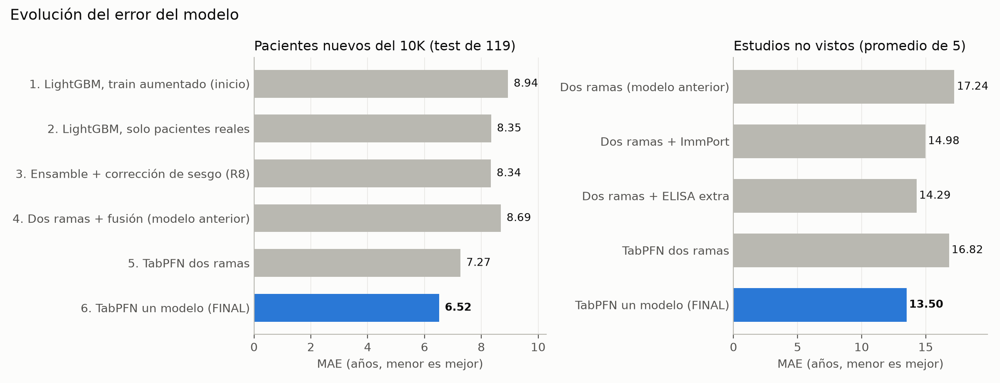
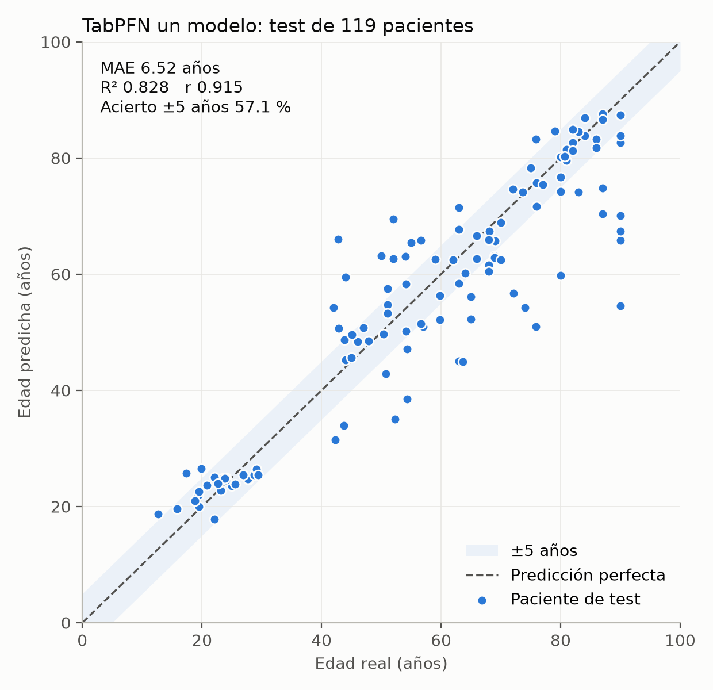
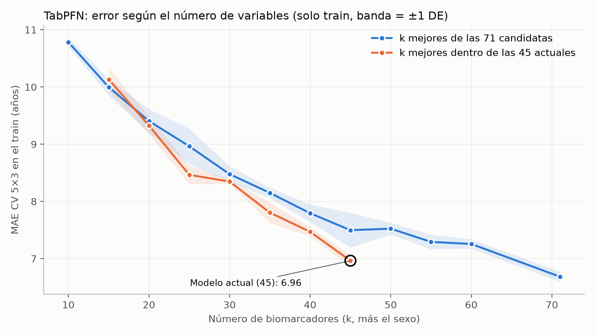
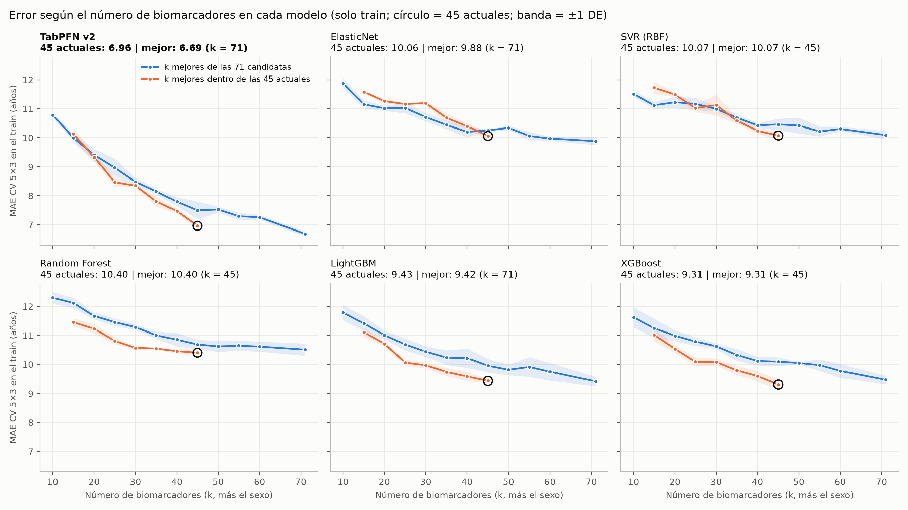
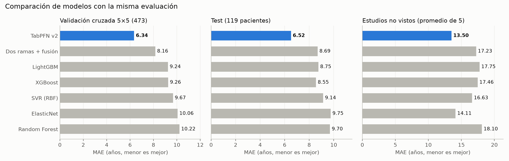

# Documentación del modelo de edad inmunológica – Immuno-XAI (Modelo 2)

Este documento explica qué modelo quedó como definitivo, por qué se entrenó así, qué se probó antes, y qué resultados llevaron a cada decisión. Cada cifra sale de un archivo de resultados de esta carpeta; la ruta se indica en cada tabla.

---

## 1. Resumen

**Modelo final:** TabPFN v2 como **un solo modelo**, que recibe juntas las células inmunes y las citoquinas.

| | |
|---|---|
| Datos | Stanford 10K Immunomes (datos normalizados), 473 pacientes con células y citoquinas medidas en la misma visita |
| Entrenamiento | 354 pacientes reales (sin copias con ruido ni mixup) |
| Test | 119 pacientes que el modelo nunca vio (los mismos de `df_test_puro_k45.csv`) |
| Variables | Los 45 biomarcadores originales (16 poblaciones celulares + 29 citoquinas) + sexo |
| Algoritmo | TabPFN v2 (transformer pre-entrenado para tablas), con sus valores por defecto |
| Script | `src/06_modelo_final_tabpfn.py` → resultados en `resultados/modelo_final/` |

**Métricas principales**

| Evaluación | MAE (años) | R² | r | Acierto ±5 años |
|---|---|---|---|---|
| Validación cruzada agrupada 5×5 (473 pacientes) | 6,34 ± 0,11 | 0,848 | 0,922 | 55,7 % |
| Test (119 pacientes) | **6,52** | **0,828** | 0,915 | 57,1 % |
| Estudios no vistos (promedio de 5) | 13,5 | −4,50* | 0,588 | 24,1 % |

\* El R² medio en estudios no vistos sale negativo por SDY113 (solo personas de 19 a 31 años; ver la sección 8). En esa prueba, el MAE y la r son más informativos.

Frente al modelo anterior (dos ramas con fusión), el error en el test baja de 8,69 a 6,52 años (mejora de 2,18 años, IC95 1,08 a 3,26) y el error en estudios no vistos baja de 17,2 a 13,5 años.





---

## 2. Objetivo

Estimar la **edad cronológica** de una persona a partir de su perfil inmune (proporciones de células inmunes medidas por CyTOF y niveles de citoquinas en suero). La diferencia entre la edad predicha y la real es la **brecha de edad inmunológica**: si es positiva, el sistema inmune "parece" más viejo que la persona.

---

## 3. Datos

### 3.1 Origen

**Stanford 10K Immunomes** (Zalocusky et al., 2018; repositorio `buttelab/10kimmunomes_v2`). Reúne datos de ImmPort de varios estudios de Stanford. El 10K publica las células y las citoquinas en archivos separados; para este proyecto se unieron por paciente y visita.

Se usan los archivos **normalizados** (`cytof_pbmc_normalized.csv` y `multiplexELISA_normalized.csv`). El 10K ya aplicó una corrección de lote tipo ComBat entre estudios, pero esa corrección no elimina por completo las diferencias entre laboratorios (ver la sección 8).

### 3.2 Conjuntos

| Conjunto | Pacientes | Uso |
|---|---|---|
| Train | 354 | Entrenar el modelo |
| Test | 119 | Evaluar una sola vez al final; nunca se usó para decidir |
| Total pareado | 473 | Validación cruzada y prueba de estudios no vistos |

- El train viene de `df_train_aumentado_k45.csv`, quedándose solo con las filas reales (`source_type = original`). Se quitó un paciente (SUB134312) que también estaba en el test.
- Todos los archivos de datos (`df_*.csv`, `pareados.csv` y los originales del 10K) están en `Datasets/`.
- La tabla de trabajo es `pareados.csv` (columna `conjunto` = train/test). La genera `src/04_construir_fuentes_unimodales.py`. Tiene los mismos pacientes que los archivos k45, con los valores tomados directamente de los archivos normalizados del 10K.
- **Diferencia con los archivos k45:** en `df_test_puro_k45.csv` los valores faltantes vienen rellenados (114 valores de 15 citoquinas, por ejemplo IL6 y FGF2), y unas pocas poblaciones celulares difieren levemente en 1 a 9 pacientes. En `pareados.csv` los faltantes quedan vacíos, y TabPFN los maneja directamente sin rellenar. El modelo final se evaluó con `pareados.csv` (MAE test 6,52). Si se evalúa el mismo modelo sobre `df_test_puro_k45.csv` tal cual, el MAE es 6,64. Si se entrena con `df_train_reales_k45.csv` y se evalúa en `df_test_puro_k45.csv`, es 6,51 (etapa 10, experimento B).

### 3.3 Variables (46)

- **16 poblaciones celulares:** linfocitos T, CD4, CD8, naive/memoria central/efectoras CD4 y CD8, Tregs, T gamma-delta, NKT, linfocitos B, plasmablastos, monocitos y monocitos CD16+/CD16−.
- **29 citoquinas:** IL6, VCAM1, HGF, CXCL8, IFN1, IFNG, IL1R1, CXCL9, IL13, NGF, ICAM1, FGF2, FASLG, CCL3, IL15, LEP, CCL7, CCL4, TGFB1, IL2, IFNB1, RETN, CD40LG, CXCL5, IL4, TNF, IL5, CCL2 y CSF1.
- **Sexo** (1 = hombre).

La lista exacta, en el orden que espera el modelo, está en `modelos/variables_modelo.csv`.

---

## 4. Cómo se evaluó cada modelo

### 4.1 Métricas

| Métrica | Qué significa | Mejor si… |
|---|---|---|
| **MAE** | Error medio en años entre edad real y predicha | Más bajo |
| **RMSE** | Como el MAE, pero castiga más los errores grandes | Más bajo |
| **R²** | Proporción de la variación de edad que explica el modelo (1 = perfecto) | Más alto |
| **r** | Correlación: si el modelo ordena bien a las personas de más joven a más vieja | Más alto |
| **Acierto ±5 años** | % de pacientes con error de 5 años o menos | Más alto |

### 4.2 Tres pruebas

1. **Validación cruzada agrupada por paciente (5×5).** Los 473 pacientes se dividen en 5 grupos; se entrena con 4 y se evalúa en el quinto, rotando. Se repite 5 veces con divisiones distintas. "Agrupada" significa que **todas las filas de un mismo paciente quedan del mismo lado**, para que el modelo nunca se evalúe con alguien que ya vio. **Esta es la prueba con la que se tomaron las decisiones.**
2. **Test de 119 pacientes.** El modelo se entrena solo con los 354 de train y se evalúa una vez en el test. Confirma lo que dice la validación cruzada.
3. **Estudios no vistos.** Se deja fuera un estudio completo (SDY420, SDY515, SDY519, SDY113 o SDY311), se entrena con el resto y se evalúa en el estudio excluido. Simula usar el modelo con datos de otro laboratorio.

### 4.3 Intervalos de confianza

Para saber si una mejora en el test es real o suerte, se usó **bootstrap pareado**: se remuestrean los 119 pacientes 5.000–10.000 veces y se calcula la diferencia de error entre dos modelos en cada remuestreo. Si el intervalo del 95 % no incluye el 0, la mejora es significativa.

---

## 5. Cronología: qué se probó, qué pasó y qué se decidió

### Etapa 1 – Modelo inicial: 5 algoritmos con datos aumentados

**Qué se hizo:** `Entrenamiento.py` entrenó ElasticNet, SVR, Random Forest, LightGBM y XGBoost con `df_train_aumentado_k45.csv` (1.014 filas: 357 pacientes reales + 357 copias con ruido + 300 mezclas tipo mixup) y los evaluó en `df_test_puro_k45.csv`.

| Modelo | MAE "CV train" | MAE test | R² test |
|---|---|---|---|
| ElasticNet | 10,37 | 11,65 | 0,607 |
| SVR | 2,30 | 12,18 | 0,525 |
| Random Forest | 5,31 | 9,98 | 0,671 |
| **LightGBM** | 3,57 | **8,94** | **0,739** |
| XGBoost | 3,47 | 9,28 | 0,724 |

*Fuente: `experimentos/01_modelo_inicial/resultados/graficos_entrenamiento_multimodal/comparativa_modelos_multimodal.csv`*

**Problema detectado:** el error de validación cruzada (3,5 años) era mucho menor que el del test (8,9 años). Las copias con ruido de un paciente caían en el entrenamiento y en la validación a la vez, así que el modelo se "evaluaba" con pacientes que ya conocía (**fuga de datos**). La validación cruzada dejó de ser confiable para elegir modelos.

### Etapa 2 – Buscar más datos del mismo tipo

| Intento | Qué se agregó | MAE test LightGBM | ¿Mejoró? |
|---|---|---|---|
| Base | — | 8,94 | — |
| 10K ampliado | 74 pacientes del 10K con CyTOF y citoquinas de otra visita (~1 año después) | 9,21 | No |
| FluPRINT | Donantes de FluPRINT (Stanford HIMC), calibrados a la escala del 10K | 9,15 | No |

*Fuentes: `experimentos/01_modelo_inicial/resultados/graficos_entrenamiento_multimodal_ampliado/` y `experimentos/01_modelo_inicial/resultados/graficos_entrenamiento_multimodal_fluprint/` (`comparacion_actual_vs_*.csv`)*

**Conclusión:** sumar pacientes de otras visitas o de otro dataset no ayudó; las diferencias de laboratorio y de momento de medición pesaban más que el beneficio de tener más filas.

### Etapa 3 – Curva de aprendizaje

Se entrenó LightGBM con el 25 %, 50 %, 75 % y 100 % de los pacientes de train.

| Pacientes reales | MAE con aumento | MAE sin aumento |
|---|---|---|
| 88 (25 %) | 11,38 | 11,44 |
| 175 (50 %) | 10,04 | 10,16 |
| 261 (75 %) | 9,41 | 9,06 |
| 349 (100 %) | 8,86 | **8,13** |

*Fuente: `experimentos/02_mas_pacientes/resultados/curva_aprendizaje_resumen.csv`*

**Conclusiones:** (1) más pacientes reales sí bajan el error, porque la curva aún no se aplana; (2) **el aumento de datos empeora el modelo** cuando hay suficientes pacientes.

### Etapa 4 – Solo pacientes reales y validación cruzada agrupada

Se reentrenaron los 5 modelos con los 354 pacientes reales (`src/02_preparar_train_reales.py`), buscando hiperparámetros con validación cruzada agrupada por paciente.

| Modelo | MAE test con aumento | MAE test solo reales | Diferencia |
|---|---|---|---|
| SVR | 12,18 | 10,10 | −2,08 (significativa) |
| LightGBM | 8,94 | **8,35** | −0,60 (94 % de probabilidad de mejora) |
| XGBoost | 9,28 | 8,73 | −0,55 |

*Fuente: `experimentos/01_modelo_inicial/resultados/graficos_entrenamiento_multimodal_reales_k45/comparacion_actual_vs_reales_k45.csv`*

**Decisión:** se abandona el aumento de datos. Desde aquí, todo se entrena solo con pacientes reales y se decide con validación cruzada agrupada.

### Etapa 5 – Banco de pruebas: ideas para bajar el error

`banco_pruebas.py` probó más variables, razones inmunes (por ejemplo CD4/CD8), selección de variables, ensambles y corrección del sesgo de regresión a la media. Las ideas se eligieron por validación cruzada; el test solo se reportó.

| Receta | MAE CV | MAE test |
|---|---|---|
| R0 LightGBM, 45 variables | 9,33 | 8,79 |
| R2 + razones inmunes | 8,99 | 8,84 |
| R5 Ensamble de 4 modelos | 8,90 | 8,78 |
| R6 Ensamble + corrección de sesgo | 8,52 | 8,13 |
| **R8 Ensamble + corrección de sesgo, top-35 de 71 variables + razones** | **8,34** | 8,34 |

*Fuente: `experimentos/03_banco_pruebas/resultados/evaluacion_final.csv`*

También se probó agregar la cohorte **Sound Life** (Allen Institute; otras tecnologías: single-cell RNA y Olink). Empeoró o no cambió nada (R8: 8,34 → 8,35 en validación cruzada). *Fuente: `experimentos/03_banco_pruebas/resultados/evaluacion_soundlife.csv`*

### Etapa 6 – Plan B: dos modelos separados (células / citoquinas) + fusión

**Idea:** entrenar un modelo con células y otro con citoquinas, para poder sumar datasets que tengan solo una de las dos, y combinarlos con una regresión lineal (fusión).

**Algoritmos por rama** (validación cruzada, solo pacientes pareados):

| Algoritmo | Células: MAE / R² | Citoquinas: MAE / R² |
|---|---|---|
| ElasticNet | 10,91 / 0,662 | 14,53 / 0,384 |
| SVR | 10,64 / 0,676 | 12,79 / 0,484 |
| Random Forest | 11,58 / 0,625 | 11,30 / 0,613 |
| LightGBM | 10,80 / 0,657 | **10,30 / 0,663** |
| XGBoost | 10,68 / 0,671 | 10,34 / 0,660 |
| KNN | 11,88 / 0,552 | 12,52 / 0,483 |
| **Ensamble de 4** | **10,41 / 0,684** | 10,92 / 0,625 |

*Fuente: `experimentos/04_dos_ramas/resultados/modelos_por_rama.csv`*

**Fuentes externas por rama:**

| Rama | Fuente agregada | Cambio en MAE CV | ¿Ayudó? |
|---|---|---|---|
| Células | CyTOF extra del 10K (111 personas) | −0,12 | Levemente |
| Células | Citometría de flujo del 10K | +0,28 | No |
| Células | FluPRINT CyTOF / Sound Life | +0,06 a +0,08 | No |
| Citoquinas | ELISA extra del 10K (492 filas) | +0,64 | No (empeora) |
| Citoquinas | FluPRINT Luminex / Sound Life Olink | +0,05 / +0,45 | No |

*Fuente: `experimentos/04_dos_ramas/resultados/fuentes_por_rama.csv`*

**Resultado:** dos ramas con solo pareados dio MAE CV 8,56 frente a 8,27 de un solo modelo con los mismos datos (R8). **Separar no mejoró**, y las fuentes externas tampoco. *Fuente: `experimentos/04_dos_ramas/resultados/evaluacion_dos_ramas.csv`*

### Etapa 7 – Diagnóstico: la "firma del estudio"

¿Por qué los datos externos no ayudaban? Se descubrió que **las variables delatan de qué estudio viene cada paciente**:

- Con solo las citoquinas, un clasificador adivina el estudio de origen el **97 %** de las veces; con las células, el **69 %**.
- Los estudios tienen rangos de edad muy distintos (por ejemplo, SDY113 solo tiene personas de 19 a 31 años y SDY420 de 41 a 90).
- Entonces el modelo puede aprender un atajo: "este perfil es del estudio X → la persona tiene unos 25 años". Funciona dentro del 10K, pero no en otro laboratorio.

Al dejar un estudio fuera, la rama de citoquinas pierde casi toda su capacidad (r medio ≈ 0,10), mientras que la de células la conserva (r ≈ 0,57). *Fuentes: `diagnostico_estudio.py`, `experimentos/04_dos_ramas/resultados/diagnostico_estudio_fuera.csv`*

**Intentos de quitar la firma:**

| Transformación de citoquinas | Acierto de estudio | r en estudios no vistos | MAE CV |
|---|---|---|---|
| Sin transformar | 96,8 % | 0,10 | 10,43 |
| CLR (log-ratio centrado) | 95,1 % | 0,16 | 12,19 |
| CLR + 10 citoquinas consistentes | 95,1 % | 0,20 | 14,72 |
| Rangos dentro de la muestra | 92,6 % | 0,15 | 12,36 |

*Fuente: `experimentos/04_dos_ramas/resultados/citoquinas_transformaciones.csv`*

**Conclusión:** las transformaciones mejoran un poco la robustez, pero empeoran mucho el error dentro del 10K, y la firma sigue ahí (más del 92 %). Las fuentes externas mejoran la robustez en estudios no vistos, pero empeoran el error dentro del 10K. Hay un compromiso entre precisión en el 10K y generalización.

### Etapa 8 – Primer modelo final: dos ramas, solo 10K

Por factibilidad, se decidió usar solo el 10K con sus datos extra. Se dejó como modelo final la versión sin el ELISA extra, por ser la más precisa dentro del 10K.

| Variante | MAE CV 5×5 | MAE test | MAE estudios no vistos |
|---|---|---|---|
| **Dos ramas, sin ELISA extra (modelo final anterior)** | **8,16** | **8,69** | 17,2 |
| Dos ramas + ELISA extra del 10K | 8,27 | 8,87 | 14,3 |
| Dos ramas + estudios de ImmPort (SDY1468/1481/1483/1484) | 8,67 | 9,68 | 15,0 |

*Fuentes: `experimentos/05_modelo_dos_ramas/resultados/modelo_final/`, `experimentos/05_modelo_dos_ramas/resultados/modelo_final_con_elisa/`, `experimentos/05_modelo_dos_ramas/resultados/modelo_final_immport/` (`metricas_modelo_final.csv`)*

Fusión: edad = −15,21 + 0,75·células + 0,54·citoquinas. Detalle en `experimentos/05_modelo_dos_ramas/resultados/modelo_final/RESUMEN_MODELO_FINAL.md`.

### Etapa 9 – Modelos más pesados

**Por qué no un LLM:** los modelos de lenguaje están hechos para texto. Con una tabla de números y pocos cientos de pacientes no aportan y suelen rendir peor que los modelos especializados. Lo equivalente para tablas son los **modelos fundacionales tabulares**:

- **TabPFN v2:** transformer pre-entrenado con millones de tablas sintéticas. No se "entrena" en el sentido clásico: recibe los pacientes de train como contexto y predice los nuevos en una sola pasada. Está diseñado para tablas pequeñas (hasta ~10.000 filas).
- **TabM** y **RealMLP:** redes neuronales modernas para tablas (librería `pytabkit`).

Se probaron en cada rama del modelo de dos ramas (validación cruzada 3×5, mismas particiones para todos):

| Rama | Modelo | MAE CV | R² CV | MAE test |
|---|---|---|---|---|
| Células | Actual (ensamble) | 10,22 | 0,690 | 10,91 |
| Células | **TabPFN v2** | **9,48** | **0,727** | **9,49** |
| Células | TabM | 10,41 | 0,676 | 10,83 |
| Células | RealMLP | 10,73 | 0,639 | 10,50 |
| Citoquinas | Actual (LightGBM) | 10,31 | 0,663 | 9,62 |
| Citoquinas | **TabPFN v2** | **7,80** | **0,767** | **7,31** |
| Citoquinas | TabM | 13,27 | 0,469 | 12,41 |
| Citoquinas | RealMLP | 12,29 | 0,493 | 11,69 |

Mejor fusión: TabPFN + TabPFN, con MAE CV 7,16 y test 7,27 (frente a 8,23 / 8,69 del modelo anterior en las mismas particiones). La mejora en test fue de 1,43 años (IC95 0,58 a 2,29). *Fuente: `experimentos/06_tabpfn/resultados/modelos_pesados/` (script `modelos_pesados.py`)*

**Conclusión:** TabPFN gana con claridad. TabM y RealMLP no, porque con ~380 pacientes las redes neuronales no tienen datos suficientes.

### Etapa 10 – TabPFN como un solo modelo (como al inicio)

Se volvió a la idea original: un solo modelo con células y citoquinas juntas, ahora con TabPFN.

| Experimento | MAE CV | MAE test | R² test | Acierto ±5 años |
|---|---|---|---|---|
| A) Train aumentado k45 (como al inicio) | — | 7,05 | 0,821 | 47,9 % |
| B) k45 solo pacientes reales | — | 6,51 | 0,827 | 56,3 % |
| **C1) 473 pareados, 45 biomarcadores** | **6,37** | **6,52** | 0,828 | 57,1 % |
| C2) 473 pareados, todas las variables (82) | 6,43 | 6,70 | 0,828 | 59,7 % |
| Referencia: TabPFN dos ramas | 7,16 | 7,27 | 0,838 | 45,4 % |

*Fuente: `experimentos/06_tabpfn/resultados/tabpfn_un_modelo/metricas_tabpfn_un_modelo.csv` (script `tabpfn_un_modelo.py`)*

**Conclusiones:**
- Un solo modelo supera a las dos ramas. TabPFN aprovecha la relación entre células y citoquinas cuando las ve juntas; la fusión lineal solo puede sumar dos predicciones.
- Los 45 biomarcadores originales bastan; agregar más variables no mejora.
- El aumento de datos vuelve a empeorar (7,05 frente a 6,51).

### Etapa 11 – Estudios no vistos con TabPFN

Faltaba comprobar si la mejora venía de explotar más la firma del estudio.

| Estudio no visto (edades) | Modelo anterior (fusión) | TabPFN dos ramas | **TabPFN un modelo (45)** | TabPFN solo células |
|---|---|---|---|---|
| SDY420 (41–90) | 18,4 | 11,0 | 11,9 | 12,1 |
| SDY515 (12–82) | 16,8 | 19,6 | 14,4 | 11,0 |
| SDY519 (20–75) | 10,7 | 13,9 | 10,8 | 12,1 |
| SDY113 (19–31) | 19,1 | 18,9 | 13,8 | 11,1 |
| SDY311 (23–90) | 21,2 | 20,7 | 16,5 | 15,4 |
| **Promedio MAE** | 17,2 | 16,8 | **13,5** | 12,3 |
| r medio | 0,52 | 0,51 | **0,59** | 0,61 |

*Fuente: `experimentos/06_tabpfn/resultados/tabpfn_un_modelo/estudios_no_vistos_resumen.csv` (script `tabpfn_estudios_no_vistos.py`)*

**Conclusión:** el modelo único no solo es mejor dentro del 10K, también **generaliza mejor** que el modelo anterior. La fusión de dos ramas generaliza peor porque le da mucho peso a la rama de citoquinas, que dentro del 10K funciona muy bien pero se cae fuera de su estudio (MAE ≈ 25). La rama de células sola es la más robusta (12,3), pero dentro del 10K es claramente peor (9,49 frente a 6,52).

### Etapa 12 – ¿Cuántas variables necesita cada modelo?

Las 45 variables vienen de los archivos k45: se eligieron al inicio del proyecto, con otros modelos y con datos aumentados. Faltaba revisar si 45 también es el número adecuado para TabPFN.

- **Candidatas:** los 71 biomarcadores con al menos 80 % de datos en el train: las 45 actuales, 8 poblaciones celulares más y 18 citoquinas más. El sexo siempre se incluye.
- **Orden:** de mayor a menor correlación con la edad (Spearman, en valor absoluto), calculada solo con los pacientes de entrenamiento de cada partición.
- **Elección:** validación cruzada agrupada 5×3 solo con los 354 de train. El test no se usó para elegir.
- **Confirmación:** el mejor número de cada curva, si no era el actual, se evaluó igual que el modelo final (validación cruzada 5×5 con 473, test y estudios no vistos).

MAE de la validación cruzada en el train (años). Es más alto que el 6,34 del modelo final porque cada partición entrena con menos pacientes (283 en vez de 378).

| Biomarcadores | Los k mejores dentro de las 45 actuales | Los k mejores de las 71 candidatas |
|---|---|---|
| 15 | 10,13 | 10,00 |
| 25 | 8,47 | 8,96 |
| 35 | 7,81 | 8,15 |
| 40 | 7,47 | 7,79 |
| 45 | **6,96 (modelo actual)** | 7,50 |
| 55 | — | 7,29 |
| 60 | — | 7,26 |
| 71 (todas) | — | 6,69 |



Solo las 71 bajaron el error del modelo actual en el train (−0,28 años), así que se confirmaron con la evaluación completa:

| Evaluación | Modelo actual (45) | Las 71 candidatas |
|---|---|---|
| Validación cruzada 5×5 (473 pacientes) | 6,34 | 6,39 |
| Test (119 pacientes) | 6,52 | 6,29 (−0,23; IC95 −0,67 a +0,19) |
| Estudios no vistos (promedio de 5) | **13,5** | 14,3 |

*Fuente: `experimentos/07_numero_variables/resultados/` (`curva_numero_variables.csv`, `confirmacion.csv`; script `numero_variables.py`)*

**Conclusiones:**
- Quitar variables siempre empeora: con 40 de las 45 el error sube 0,5 años y con 30 sube 1,4. TabPFN aprovecha todas, incluso las que por sí solas casi no se relacionan con la edad (VCAM1, CCL7, IFN1).
- Las 45 actuales superan a las 45 más correlacionadas de las 71 (6,96 frente a 7,50). La selección original funciona bien y ordenar las variables una a una no la mejora.
- Las 71 no confirman su ventaja: empatan en la validación cruzada con 473 (+0,04), mejoran el test en 0,23 años sin que sea significativo (el IC95 incluye el 0) y empeoran 0,8 años en estudios no vistos, sobre todo en SDY113 (13,8 → 16,4) y SDY420 (11,9 → 13,2). Las citoquinas extra parecen sumar más firma del estudio que información sobre la edad.
- **Se mantienen los 45 biomarcadores.** Coincide con la etapa 10, donde usar todas las variables (82) tampoco mejoró.

**¿Y los demás modelos?** La prueba anterior se hizo solo con TabPFN, así que se repitió con los cinco modelos clásicos del paso 05, con el mismo diseño: las mismas candidatas, las mismas particiones y el orden de las variables recalculado dentro de cada partición. Cada modelo usó los hiperparámetros elegidos en el paso 05, fijos para todos los k (como en la curva de sondas del modelo epigenético), para que la curva muestre solo el efecto del número de variables. El modelo de dos ramas no se incluyó porque usa su propio conjunto de variables.

| Modelo | MAE CV en train con las 45 | Mejor configuración en train | Confirmación con la evaluación completa |
|---|---|---|---|
| TabPFN v2 | **6,96** | 71 candidatas (6,69) | No se confirma: CV 6,34 → 6,39; test 6,52 → 6,29 (no significativo); estudios no vistos 13,5 → 14,3 |
| XGBoost | 9,31 | Las 45 actuales | — |
| LightGBM | 9,43 | 71 candidatas (9,42; empate) | No se confirma: CV 9,25 → 9,31; test 9,05 → 8,89 (IC95 −0,72 a +0,41); estudios no vistos 17,7 → 18,8 |
| ElasticNet | 10,06 | 71 candidatas (9,88) | No se confirma: CV 9,91 frente a 10,06; test 9,74 frente a 9,75; estudios no vistos 14,1 → 15,4 |
| SVR (RBF) | 10,07 | Las 45 actuales | — |
| Random Forest | 10,40 | Las 45 actuales | — |



*Fuente: `experimentos/07_numero_variables/resultados/` (`curva_numero_variables_clasicos.csv`, `confirmacion_clasicos.csv`; script `numero_variables_clasicos.py`, unos 3 minutos)*

- **En los seis modelos, quitar biomarcadores de los 45 siempre empeora el error.**
- **Ningún modelo mejora de forma confirmada con más variables.** Cuando las 71 mejoran un poco dentro del 10K, empeoran en estudios no vistos (ElasticNet +1,3 años, LightGBM +1,0, TabPFN +0,8): el mismo patrón de TabPFN, porque las citoquinas extra aportan más firma del estudio.
- **TabPFN tiene el menor error con cualquier número de variables**, entre 0,7 y 2,7 años menos que el mejor modelo clásico. Su ventaja no se debe a que los 45 biomarcadores le convengan más que a los demás.
- En la confirmación, LightGBM con las 45 dio 9,05 años en el test, frente a 8,75 en el paso 05. La única diferencia es el orden de las columnas, que cambia el muestreo aleatorio de LightGBM; muestra que diferencias de unas décimas en el test entre ejecuciones son ruido.

---

## 6. Por qué se eligió TabPFN un modelo con 45 biomarcadores

| Criterio | Evidencia |
|---|---|
| Menor error dentro del 10K | MAE CV 5×5 6,34 y MAE test 6,52, los más bajos de todo el proyecto |
| La mejora no es suerte | 2,18 años menos que el modelo anterior en el test, IC95 1,08 a 3,26 |
| Validación cruzada y test coinciden | Validación cruzada 6,34 frente a test 6,52: no hay señales de sobreajuste |
| Mejor generalización entre los modelos multimodales | MAE en estudios no vistos 13,5, frente a 17,2 del modelo anterior; mejora o empata en los 5 estudios |
| Número de variables adecuado | Quitar cualquiera de las 45 empeora; agregar las 26 restantes no mejora de forma confirmada y empeora en estudios no vistos; lo mismo ocurre en los cinco modelos clásicos (etapa 12) |
| Más simple | Un solo modelo, 46 variables, sin búsqueda de hiperparámetros ni fusión |
| Consistente con lo aprendido | Sin aumento de datos (etapas 3, 4 y 10) y sin datos externos (etapas 2, 5 y 6) |

**Alternativa considerada:** TabPFN con solo células es más robusto en estudios no vistos (12,3 frente a 13,5), pero dentro del 10K pierde 3 años de precisión (9,49 frente a 6,52). Se prefirió el modelo con ambas modalidades.

### 6.1 Comparación final con la misma evaluación

Las etapas de la sección 5 se hicieron en momentos distintos y no siempre con la misma evaluación. Para comparar en igualdad de condiciones, `src/05_comparar_modelos.py` vuelve a entrenar los modelos principales con los mismos 473 pacientes, las mismas particiones y las mismas tres pruebas que el modelo final.

- Los 5 modelos clásicos usan las mismas 46 variables que TabPFN. Sus hiperparámetros se eligen con 30 combinaciones al azar y validación cruzada agrupada, solo con los 354 de train.
- El modelo de dos ramas usa su propio diseño (sección 5, etapa 8).
- TabPFN usa sus valores por defecto.

| Modelo | MAE CV 5×5 | MAE test | R² test | Acierto ±5 años (test) | MAE estudios no vistos | TabPFN mejor en el test por (IC95) |
|---|---|---|---|---|---|---|
| **TabPFN v2 (final)** | **6,34** | **6,52** | **0,828** | **57,1 %** | **13,5** | — |
| Dos ramas + fusión | 8,16 | 8,69 | 0,766 | 36,1 % | 17,2 | 2,18 (1,08 a 3,26) |
| LightGBM | 9,24 | 8,75 | 0,732 | 41,2 % | 17,8 | 2,24 (1,06 a 3,45) |
| XGBoost | 9,26 | 8,55 | 0,753 | 39,5 % | 17,5 | 2,05 (0,93 a 3,17) |
| SVR (RBF) | 9,67 | 9,14 | 0,737 | 33,6 % | 16,6 | 2,63 (1,31 a 3,99) |
| ElasticNet | 10,06 | 9,75 | 0,717 | 28,6 % | 14,1 | 3,23 (1,88 a 4,61) |
| Random Forest | 10,22 | 9,70 | 0,680 | 35,3 % | 18,1 | 3,18 (1,92 a 4,51) |

*Fuente: `resultados/comparacion_modelos/resumen_comparacion.csv`. Las cifras de TabPFN y de dos ramas son idénticas, paciente por paciente, a las de `resultados/modelo_final/` y `experimentos/05_modelo_dos_ramas/resultados/modelo_final/`.*



- **TabPFN es el mejor en las tres pruebas.** En el test le saca entre 2,0 y 3,2 años a cada modelo, y ningún intervalo de confianza incluye el cero.
- **Entre los clásicos, LightGBM y XGBoost son los mejores dentro del 10K** (MAE de validación cruzada ≈ 9,25). El modelo de dos ramas los supera (8,16) gracias a sus variables extra y a la fusión.
- **ElasticNet es el peor dentro del 10K, pero el segundo mejor en estudios no vistos** (14,1). Un modelo lineal simple se apoya menos en la firma de cada estudio (etapa 7). Aun así, TabPFN lo supera en 4 de los 5 estudios; la excepción es SDY311 (26 pacientes: 16,5 frente a 14,8).
- **Los hiperparámetros se eligieron con el train**, pero la validación cruzada 5×5 usa los 473 pacientes. Esto puede bajar un poco el error de los modelos afinados en esa prueba, no el de TabPFN, que no se afina. Por eso la ventaja de TabPFN no está exagerada.

---

## 7. Explicabilidad: qué mira el modelo

TabPFN no entrega coeficientes ni importancias propias, así que se usaron métodos que funcionan con cualquier modelo. Todos usan el modelo entrenado con los 354 pacientes de train y se calculan sobre el test de 119 (script `src/08_explicabilidad.py`, resultados en `resultados/explicabilidad/`).

### 7.1 Importancia por permutación

Se desordena una variable entre los pacientes de test, se vuelve a predecir y se mide cuánto sube el MAE (5 repeticiones). El MAE base es 6,52 años.

| Puesto | Variable | Tipo | Aumento del MAE (años) |
|---|---|---|---|
| 1 | Naive_CD8_T_cells | Célula | **+4,99** ± 0,88 |
| 2 | IL1R1 | Citoquina | +1,77 ± 0,12 |
| 3 | IFN1 | Citoquina | +1,45 ± 0,22 |
| 4 | Effector_CD8_T_cells | Célula | +1,27 ± 0,29 |
| 5 | CD4_T_cells | Célula | +1,15 ± 0,14 |
| 6 | CXCL9 | Citoquina | +0,81 ± 0,33 |
| 7 | Central_Memory_CD4_T_cells | Célula | +0,72 ± 0,21 |
| 8 | CD16_pos_monocytes | Célula | +0,30 ± 0,09 |
| 9 | IL2 | Citoquina | +0,29 ± 0,08 |
| 10 | RETN | Citoquina | +0,22 ± 0,03 |

*Fuente: `resultados/explicabilidad/importancia_permutacion.csv` (las 46 variables)*

**Por bloque** (se desordenan todas las variables del bloque a la vez):

| Bloque | Aumento del MAE (años) |
|---|---|
| Células (16) | +9,17 ± 1,04 |
| Citoquinas (29) | +8,87 ± 1,15 |
| Sexo | +0,10 ± 0,03 |

*Fuente: `resultados/explicabilidad/importancia_bloques.csv`*

**Lectura:**
- **Las células T CD8 vírgenes (naive) son, por lejos, el biomarcador más importante.** Es coherente con la inmunosenescencia: la producción del timo cae con la edad y las T CD8 vírgenes disminuyen. En estos datos, su correlación con la edad es −0,62.
- **Células y citoquinas aportan casi lo mismo como bloque.** El modelo necesita ambas, lo que explica por qué el modelo único supera a la rama de células sola dentro del 10K.
- **Entre las citoquinas destacan IL1R1, IFN1 y CXCL9**, ligadas a la inflamación crónica asociada a la edad (*inflammaging*). Hay que leerlas con cuidado: las citoquinas también llevan la firma del estudio (sección 5, etapa 7), así que parte de su importancia puede venir de ahí.
- **El sexo casi no influye.**

### 7.2 Perfiles de dependencia parcial

Para los 10 biomarcadores más importantes, se fija su valor en 12 puntos (percentiles 5 a 95 del train) para todos los pacientes de test y se promedia la edad predicha. Muestra hacia dónde empuja cada biomarcador. *Fuente: `resultados/explicabilidad/dependencia_parcial.csv`*

### 7.3 Explicación individual por paciente

Para cada paciente de test y cada variable, se reemplaza su valor por la mediana del train y se mide cuánto cambia su edad predicha. Un valor positivo significa que su valor real lo hace parecer mayor. Es una aproximación: los efectos no suman exactamente la predicción, porque el modelo combina variables. *Fuente: `resultados/explicabilidad/explicacion_individual_test.csv`*

### 7.4 Brecha de edad inmunológica

Se usaron las predicciones fuera de muestra de la validación cruzada 5×5 para los 473 pacientes.

- **Sesgo hacia la media:** la brecha bruta baja 0,17 años por cada año de edad: el modelo sobrestima a los jóvenes y subestima a los mayores. Se corrigió restando esa tendencia lineal (**brecha corregida**).
- **Por sexo:** brecha corregida media de +0,30 años en hombres y −0,23 en mujeres. La diferencia no es significativa (Mann-Whitney p = 0,28).
- **Biomarcadores asociados a una brecha mayor** (Spearman con la brecha corregida, q de Benjamini-Hochberg):

| Biomarcador | ρ con la brecha | q | ρ con la edad |
|---|---|---|---|
| Naive_CD8_T_cells | −0,34 | < 0,001 | −0,62 |
| Central_Memory_CD4_T_cells | +0,26 | < 0,001 | +0,37 |
| Effector_CD4_T_cells | −0,19 | < 0,001 | −0,34 |
| Central_Memory_CD8_T_cells | +0,18 | < 0,001 | +0,23 |
| B_cells | −0,18 | < 0,001 | −0,36 |
| CXCL8 | +0,19 | < 0,001 | +0,33 |

*Fuente: `resultados/explicabilidad/brecha_vs_biomarcadores.csv`*

Las personas con menos células T CD8 vírgenes y más células de memoria central parecen inmunológicamente mayores de lo que son. **Precaución:** estas asociaciones son en parte circulares, porque el modelo usa esos mismos biomarcadores para predecir. Una persona con pocas T CD8 vírgenes para su edad recibirá una edad predicha mayor. Muestran qué rasgos definen la brecha en este modelo, no una causa biológica independiente.

### 7.5 Dashboard interactivo

Los resultados del modelo y de la explicabilidad están en un dashboard con cuatro pestañas (resumen, qué mira el modelo, explorar un paciente y brecha de edad), junto con el modelo epigenético: https://claude.ai/artifact/794jg3fRxv7WYTd2cLtEKS. Los datos que lee se generan con `src/09_exportar_dashboard.py` (en `resultados/explicabilidad/dashboard/`), y la página está en `resultados/explicabilidad/dashboard/index.html`.

---

## 8. Limitaciones

1. **Firma del estudio.** El error sube de 6,52 a 13,5 años al pasar a un estudio no visto. Las citoquinas permiten reconocer el estudio de origen, y estudio y edad están mezclados en el 10K. Para usar el modelo con datos de otro laboratorio, habría que calibrarlo con muestras de ese laboratorio. Se nota en el gráfico del test: los 25 pacientes menores de 35 años tienen un error medio de 2,8 años, frente a 7,5 años en los de 35 o más, y no hay pacientes de 30 a 42 años. De esos 25 jóvenes, 14 vienen de SDY113, un estudio que solo incluye personas de 19 a 31 años. El modelo puede reconocerlos en parte por su estudio de origen: cuando SDY113 se deja fuera, su error sube a 13,8 años.
2. **R² negativo en estudios no vistos.** Pasa sobre todo en estudios con rango de edad estrecho (SDY113: 19–31 años), donde cualquier error es grande comparado con la poca variación de edad. En esa prueba, la r y el MAE son más informativos.
3. **Un solo origen de datos.** Todo viene del 10K Immunomes (Stanford). No se validó en una cohorte externa independiente.
4. **Test pequeño.** Con 119 pacientes, los intervalos de confianza son amplios (alrededor de ±1 año en las diferencias entre modelos).
5. **Errores grandes en algunos pacientes.** El MAE bajó mucho, pero el RMSE y el R² mejoraron menos: el modelo acierta mejor al paciente típico, pero aún falla por bastante en unos pocos.
6. **TabPFN en CPU.** Por defecto no acepta más de 1.000 filas en CPU (se puede forzar con `TABPFN_ALLOW_CPU_LARGE_DATASET=1`). Con 354 pacientes no es un problema.
7. **Licencia.** Se usó TabPFN v2 porque la versión más nueva (3.5) pide iniciar sesión y aceptar una licencia. Si el modelo se usa fuera del ámbito académico, conviene revisar la licencia de los pesos de TabPFN v2.
8. **Interpretabilidad.** TabPFN es menos transparente que un árbol. Se explicó con métodos que funcionan con cualquier modelo (sección 7), calculados sobre un test de 119 pacientes. No se usó SHAP exacto porque es muy costoso con TabPFN en CPU.

---

## 9. Cómo reproducirlo

Requisitos: Python 3.14 y los paquetes de `requirements.txt` (`tabpfn` 9.2 con pesos v2, `torch` en CPU, `scikit-learn`, `pandas`, `numpy`, `matplotlib`, `joblib`). La estructura de carpetas está explicada en `README.md`.

```bash
python -X utf8 src/01_ampliar_dataset.py
python -X utf8 src/02_preparar_train_reales.py
python -X utf8 src/03_reconstruir_dataset_completo.py
python -X utf8 src/04_construir_fuentes_unimodales.py
python -X utf8 src/05_comparar_modelos.py
python -X utf8 src/06_modelo_final_tabpfn.py
python -X utf8 src/07_graficos_modelo_final.py
python -X utf8 src/08_explicabilidad.py
python -X utf8 src/09_exportar_dashboard.py
python -X utf8 src/10_figuras_informe.py
```

- Los pasos 01 a 04 preparan los datos en `Datasets/` (la tabla de trabajo es `pareados.csv`). Si ya existen, se puede empezar en el paso 05.
- `src/05_comparar_modelos.py` entrena los 7 modelos de la sección 6.1 con la misma evaluación (unos 15 minutos en CPU). Los pasos siguientes no lo necesitan.
- `src/08_explicabilidad.py` tarda unos 45 minutos en CPU.
- `src/10_figuras_informe.py` genera las figuras, cifras y tiempos del Experimento A que usa el informe de título (`Modelo 1/Informe`), en `resultados/informe/`.
- Las rutas de todos los archivos están en `src/config.py`.

### Archivos del modelo final

En `modelos/`:

| Archivo | Contenido |
|---|---|
| `modelo_tabpfn.joblib` | Modelo entrenado con los 354 pacientes de train y la lista de variables |
| `variables_modelo.csv` | Las 46 variables en el orden que espera el modelo |

En `resultados/modelo_final/`:

| Archivo | Contenido |
|---|---|
| `metricas_modelo_final.csv` | Validación cruzada 5×5, test y promedio de estudios no vistos |
| `metricas_estudios_no_vistos.csv` | Métricas por estudio excluido |
| `comparacion_vs_modelo_anterior.csv` | Mejora en el test frente al modelo de dos ramas, con IC95 |
| `predicciones_test.csv` | Edad real, predicha y brecha de edad por paciente de test |
| `predicciones_cv.npz` | Predicciones fuera de muestra de la validación cruzada |
| `test_real_vs_predicha.png`, `evolucion_modelos.png` | Gráficos |

En `resultados/comparacion_modelos/` (paso 05, sección 6.1):

| Archivo | Contenido |
|---|---|
| `resumen_comparacion.csv` | Una fila por modelo: MAE de las tres pruebas y diferencia con TabPFN en el test (IC95) |
| `metricas_comparacion.csv`, `metricas_estudios_no_vistos.csv` | Todas las métricas, y por estudio excluido |
| `hiperparametros.csv` | Hiperparámetros elegidos para cada modelo clásico |
| `predicciones_test.csv`, `predicciones_cv.npz` | Predicciones de los 7 modelos |
| `comparacion_modelos.png` | Gráfico de la sección 6.1 |

### Scripts de cada etapa

Las etapas de la sección 5 están en `experimentos/`, cada una con sus scripts y una carpeta `resultados/`.

| Etapa | Carpeta | Script(s) |
|---|---|---|
| 1 y 4 | `experimentos/01_modelo_inicial/` | `Entrenamiento.py` (recibe el train como argumento; la versión original está en `_respaldo_original/Entrenamiento_original.py`), `comparar_resultados.py` |
| 2–3 | `experimentos/02_mas_pacientes/` | `ampliar_con_fluprint.py`, `curva_aprendizaje.py` (el train ampliado con el 10K lo genera `src/01_ampliar_dataset.py`) |
| 5 | `experimentos/03_banco_pruebas/` | `banco_pruebas.py`, `evaluacion_final.py`, `grafico_evaluacion_final.py`, `armonizar_soundlife.py`, `evaluar_datos_extra.py` |
| 6–7 | `experimentos/04_dos_ramas/` | `modelo_dos_ramas.py`, `construir_fuentes_externas.py`, `analisis_ramas.py`, `evaluar_fuentes_por_rama.py`, `diagnostico_estudio.py`, `diagnostico_estudio_fuera.py`, `diagnostico_fuentes_citoquinas.py`, `citoquinas_robustas.py` |
| 8 | `experimentos/05_modelo_dos_ramas/` | `modelo_final_dos_ramas.py`, `incorporar_immport.py` |
| 9–11 | `experimentos/06_tabpfn/` | `modelos_pesados.py`, `tabpfn_un_modelo.py`, `tabpfn_estudios_no_vistos.py` |
| 12 | `experimentos/07_numero_variables/` | `numero_variables.py` (TabPFN), `numero_variables_clasicos.py` (modelos clásicos) |
| Comparación final | `src/` | `05_comparar_modelos.py` (resultados en `resultados/comparacion_modelos/`) |
| Final | `src/` | `06_modelo_final_tabpfn.py`, `07_graficos_modelo_final.py` |
| Explicabilidad | `src/` | `08_explicabilidad.py`, `09_exportar_dashboard.py` |
| Informe de título | `src/` | `10_figuras_informe.py` (resultados en `resultados/informe/`) |

Los resultados de la etapa 1 y de los distintos trains probados con `Entrenamiento.py` (etapas 2 y 4) quedan en `experimentos/01_modelo_inicial/resultados/graficos_entrenamiento_multimodal*/`.

### Cómo usar el modelo guardado

```python
import joblib, pandas as pd
paquete = joblib.load("modelos/modelo_tabpfn.joblib")
datos = pd.read_csv("nuevos_pacientes.csv")              # mismas columnas que el 10K normalizado
X = datos[paquete["variables"][:-1]].astype(float)
X["sexo_Male"] = (datos["gender"] == "Male").astype(float)
edad_predicha = paquete["modelo"].predict(X.values.astype("float32"))
```

Los valores faltantes pueden dejarse vacíos (NaN); TabPFN los maneja sin necesidad de rellenarlos.

---

## 10. Glosario

- **Aumento de datos:** crear filas artificiales (copias con ruido o mezclas entre pacientes) para tener más datos. Aquí empeoró el modelo y generó fuga en la validación.
- **Bootstrap pareado:** remuestrear los pacientes del test muchas veces para estimar la incertidumbre de una diferencia de error entre dos modelos.
- **ComBat:** método para corregir diferencias de lote (laboratorio, día de medición) entre estudios.
- **Firma del estudio:** patrón en los datos que delata de qué estudio o laboratorio viene una muestra, sin relación con la biología de la persona.
- **Fuga de datos:** cuando información del conjunto de evaluación se cuela en el entrenamiento y hace que el modelo parezca mejor de lo que es.
- **Fusión:** combinar las predicciones de dos modelos (aquí, una regresión lineal sobre las predicciones de células y citoquinas).
- **Validación cruzada agrupada:** dividir los datos en partes, entrenar con unas y evaluar en otra, manteniendo a cada paciente en una sola parte.
- **TabPFN:** modelo transformer pre-entrenado con millones de tablas sintéticas; predice datos nuevos usando los de entrenamiento como contexto, sin ajustar hiperparámetros.
