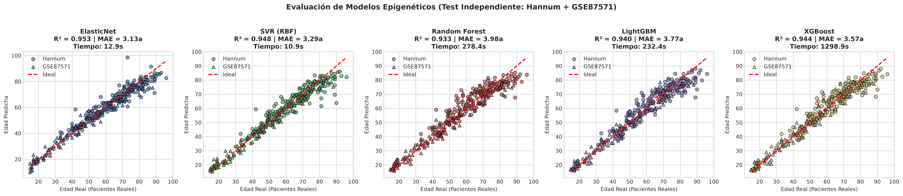
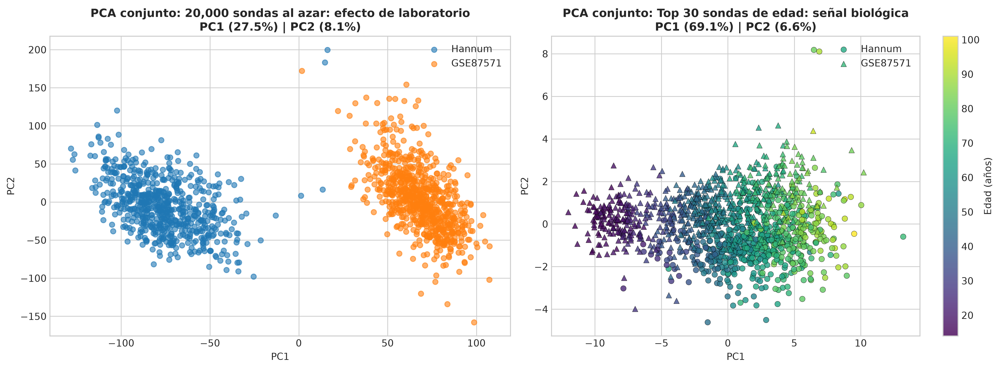
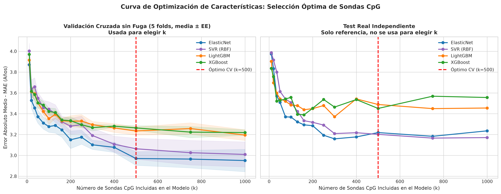
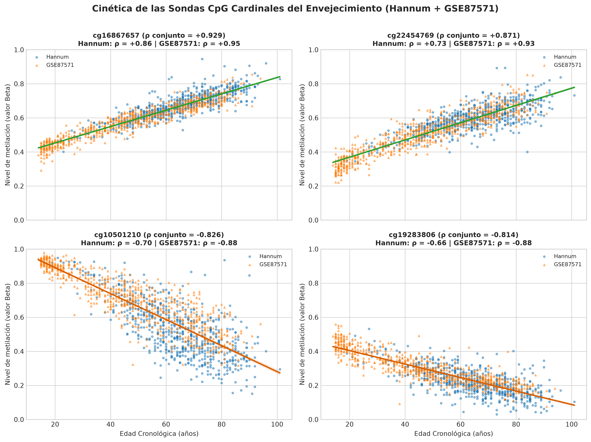
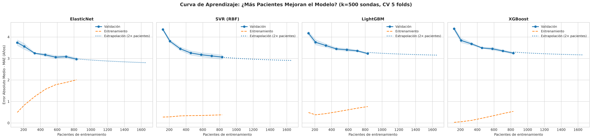

# Documentación del modelo de edad epigenética – Immuno-XAI (Modelo 1)

Este documento explica qué modelo quedó como definitivo para estimar la edad a partir de la **metilación del ADN**, cómo se entrenó, qué se probó antes y qué resultados llevaron a cada decisión. Cada cifra sale de un archivo de `resultados/modelo_epigenetico/`; los originales y los scripts que los generan están en `D:\Claude Code\Titulo\Modelo 1`.

---

## 1. Resumen

**Modelo final:** ElasticNet (regresión lineal regularizada) con **500 sondas CpG + sexo**.

| | |
|---|---|
| Datos | Dos cohortes públicas de GEO con metilación de sangre completa (array Illumina 450K): Hannum GSE40279 (656 personas, EE. UU.) y Johansson GSE87571 (729 personas, Suecia) |
| Entrenamiento | 1.038 pacientes reales (Hannum 492 + GSE87571 546). Sin datos sintéticos |
| Test | 347 pacientes que el modelo nunca vio (Hannum 164 + GSE87571 183) |
| Variables | 500 sondas CpG elegidas entre las 470.043 del array + sexo (501 en total) |
| Algoritmo | ElasticNet con estandarización (`alpha = 0,1`, `l1_ratio = 0,3`); 320 de las 501 variables quedan con coeficiente distinto de 0 |
| Scripts | `Modelo 1/src/05_entrenamiento.py` (comparación de 5 modelos) y `Modelo 1/src/07_guardar_elasticnet.py` (entrena y guarda este modelo) |

**Métricas principales** (`resultados/modelo_epigenetico/metricas_modelo_final.csv`)

| Evaluación | MAE (años) | RMSE | R² | r | Acierto ±5 años |
|---|---|---|---|---|---|
| Validación cruzada, 5 folds fuera de pliegue (1.038 de train) | 2,89 | 3,93 | 0,962 | 0,981 | 84,8 % |
| **Test combinado (347)** | **3,13** | **4,35** | **0,953** | 0,977 | 80,4 % |
| Test Hannum (164) | 3,91 | 5,31 | 0,882 | 0,941 | 72,0 % |
| Test GSE87571 (183) | 2,44 | 3,25 | 0,974 | 0,988 | 88,0 % |

**Cómo leer el R².** El R² combinado (0,953) es más alto que el de cada cohorte porque juntar dos cohortes con distinto rango de edad aumenta la varianza del test. Para comparar con la literatura conviene usar el test de Hannum: **MAE 3,91 años, R² 0,882**, comparable con el reloj original de Hannum et al. (≈ 3,9 años).



---

## 2. Objetivo

Estimar la **edad cronológica** de una persona a partir de la metilación del ADN en sangre. La diferencia entre la edad predicha y la real es la **brecha de edad epigenética**: si es positiva, el ADN "parece" más viejo que la persona. Es el equivalente epigenético de la brecha inmunológica del modelo de citoquinas.

---

## 3. Datos

### 3.1 Origen

| Cohorte | Personas | Edades | País | Array | Nulos |
|---|---|---|---|---|---|
| Hannum (GSE40279) | 656 | 19–101 | EE. UU. | Illumina 450K, sangre completa | 0 % |
| Johansson (GSE87571) | 729 válidas (de 732) | 14–94 | Suecia | Illumina 450K, sangre completa | 0,10 % |
| **Total** | **1.385** | **14–101** | | | |

- Ambas cohortes usan el mismo array y el mismo tejido, y comparten el 100 % de las sondas.
- **Se complementan en edad:** Hannum aporta adultos mayores (15,2 % con 80 años o más) y GSE87571 aporta jóvenes (25,5 % menores de 30).
- **El efecto de laboratorio existe, pero no afecta al modelo.** En un PCA con sondas al azar, las cohortes se separan; con las sondas de edad, se mezclan y se ordenan por edad. Además, las 500 sondas del modelo se correlacionan con la edad **dentro de cada cohorte** por separado (|ρ| ≥ 0,34 en Hannum y ≥ 0,55 en GSE87571).



### 3.2 Partición sin fuga de datos

1. **El test se separa primero:** el 25 % de cada cohorte, con `random_state = 42`.
2. **Todo lo demás usa solo train:** la imputación de nulos (mediana del train de cada cohorte), el ranking de sondas, la elección de k, los hiperparámetros y la parada temprana de los boosting.
3. **Validación cruzada:** 5 folds estratificados por cohorte.

La lista de qué paciente fue train o test (con su ID de GEO) está en `resultados/modelo_epigenetico/particion_pacientes_elasticnet.csv`.

**Verificación:** con la **prueba de permutación** (edades barajadas al azar y todo el pipeline repetido), el modelo da R² = −0,43 y −0,56. Es decir, no predice nada, que es lo esperado si no hay fuga.

---

## 4. Selección de sondas (k = 500)

Se calculó la correlación de Spearman de las 470.043 sondas con la edad (solo con train) y se probaron k ∈ {10, 20, 35, 50, 75, 100, 130, 160, 200, 250, 300, 400, 500, 750, 1000}. En cada fold, el ranking se recalculó sin los pacientes de validación.

| k | ElasticNet | SVR | LightGBM | XGBoost |
|---|---|---|---|---|
| 10 | 3,87 | 4,00 | 3,92 | 3,97 |
| 100 | 3,28 | 3,44 | 3,35 | 3,42 |
| 300 | 3,10 | 3,19 | 3,30 | 3,27 |
| **500** | **2,97** | 3,06 | 3,23 | 3,26 |
| 1000 | 2,95 | 3,01 | 3,20 | 3,22 |

*MAE en validación cruzada (años). Fuente: `curva_sondas.csv`.*

El mínimo está en k = 1.000, pero la diferencia con k = 500 (0,02 años) es menor que la variación entre folds. Con la **regla de un error estándar** se elige el modelo más simple que rinde igual: **k = 500**.



**Sondas más fuertes:** cg16867657 (gen ELOVL2, ρ = +0,93, el marcador de edad más replicado en la literatura), cg22454769 (+0,87), cg10501210 (−0,83) y cg19283806 (−0,81).



---

## 5. Cronología: qué se probó y qué se decidió

| Versión | Cambio | MAE test Hannum | Decisión |
|---|---|---|---|
| v1 | Código original: 5.000 sondas, Mixup antes de separar train y test | 4,36* | *Inflado por fuga de datos* |
| v2 | Fuga corregida (mismas 5.000 sondas) | 6,35 | El error honesto era mucho mayor |
| v3 | Todas las sondas del array (470.043), solo Hannum, k = 130 | 4,29 | Las mejores sondas (ELOVL2) no estaban entre las primeras 5.000 |
| v4 | Fusión con GSE87571, k = 500, con Mixup | 3,93 | El modelo de una sola cohorte fallaba en otro laboratorio (hasta 5,7 años) |
| **v5** | **Final: fusión, k = 500, sin datos sintéticos** | **3,91** | El Mixup nunca mejoró (±0,1 años) y se eliminó |

**Validación externa (justificó la fusión).** El modelo entrenado solo con Hannum y probado en GSE87571 tuvo un MAE de 5,3 a 5,7 años en SVR y los ensambles (ElasticNet 3,31). Al entrenar con ambas cohortes, todos los modelos mejoran en las dos.

---

## 6. Comparación de los 5 algoritmos (test combinado, 347 pacientes)

| Modelo | MAE | R² |
|---|---|---|
| **ElasticNet** | **3,13** | **0,953** |
| SVR (RBF) | 3,29 | 0,948 |
| Random Forest | 3,98 | 0,933 |
| LightGBM | 3,77 | 0,940 |
| XGBoost | 3,57 | 0,944 |

*Fuente: `comparacion_5_modelos.csv` (incluye los resultados por cohorte).*

**Por qué ElasticNet:**
1. Tiene el menor error de estimación (MAE y R²), que es el objetivo del reloj, y gana también dentro de cada cohorte.
2. Es el modelo que menos sobreajusta: la brecha entre el error de train y el de validación es de 0,96 años, frente a 2,5–2,7 en los demás.
3. Es interpretable, porque cada sonda tiene un coeficiente, y entrena en unos 11 segundos.
4. Es el mismo algoritmo del reloj original de Hannum (2013).

---

## 7. ¿Hacen falta más pacientes? (curva de aprendizaje)

| Modelo | MAE validación | MAE train | Brecha | Ganancia al duplicar pacientes | MAE mínimo estimado |
|---|---|---|---|---|---|
| ElasticNet | 2,97 | 2,01 | 0,96 | 0,18 años | 2,14 |
| SVR | 3,06 | 0,38 | 2,68 | 0,15 | 2,71 |
| LightGBM | 3,23 | 0,76 | 2,46 | 0,13 | 2,94 |
| XGBoost | 3,25 | 0,54 | 2,71 | 0,13 | 2,98 |

*Fuente: `diagnostico_datos.csv`. Ajuste por ley de potencia MAE(n) = a·n^(−b) + c, extrapolado a 2n.*

La curva está casi saturada: el límite actual no es la cantidad de pacientes.



---

## 8. Explicabilidad

ElasticNet es un modelo lineal, así que su explicación es directa:

- **Global:** cada variable tiene un coeficiente fijo (`variables_modelo.csv`, columna `coeficiente_estandarizado`). Indica cuántos años suma o resta una desviación estándar de esa sonda. Las de mayor peso son:

| Sonda | Coeficiente | Efecto |
|---|---|---|
| cg16867657 (ELOVL2) | +1,51 | Más metilación → más edad |
| cg10501210 | −1,50 | Más metilación → menos edad |
| cg14361627 | +0,96 | |
| cg06639320 | +0,87 | |
| cg26290632 | +0,72 | |

  El sexo (hombre = 1) tiene un coeficiente de −0,36. El intercepto es 54,76 años, la edad media del train.

- **Por paciente:** el aporte de cada sonda es `coeficiente × (valor estandarizado del paciente)`, y la edad predicha es el intercepto más la suma de todos los aportes. Es exactamente lo que calcula SHAP con `LinearExplainer`, que da valores exactos e instantáneos para este modelo.

- **Validación con la librería `shap` (v3.1):** `explicabilidad/shap_epigenetico_validacion.py` compara ese cálculo propio con la librería, de dos formas. Los resultados están en `resultados/explicabilidad/shap_epigenetico_validacion.csv`.

| Comprobación | Alcance | Diferencia máxima con el cálculo propio |
|---|---|---|
| `shap.LinearExplainer` (SHAP exacto de un modelo lineal, con los 1.038 pacientes de train como referencia) | 347 pacientes de test × 501 variables (173.847 aportes) | 0,0000000002 años |
| `shap.KernelExplainer` (agnóstico: solo ve las predicciones, no los coeficientes) | 10 pacientes de test × 501 variables | 0,0000000002 años |

  La base de `shap` es 54,7582 años, igual al intercepto, y el ranking de las 20 sondas principales es idéntico. Un detalle de uso: `LinearExplainer` toma por defecto solo 100 pacientes de referencia, y con eso la base cambia unos 2 años; hay que pasarle el train completo (`max_samples`).

---

## 9. Usar el modelo

```bash
python -X utf8 modelos/predecir_epigenetico.py pacientes.csv
```

- La entrada tiene una fila por paciente, una columna por sonda (valores beta de 0 a 1) y una columna `gender`. Si trae `age`, también se calcula la brecha.
- Las sondas que falten se rellenan con la mediana del train. La columna `sondas_imputadas` avisa cuántas fueron por paciente.
- Funciona con el array 450K. El array EPIC incluye la gran mayoría de estas sondas; las que falten se imputan.
- Requisitos: `scikit-learn` 1.9, `pandas`, `numpy` y `joblib`. No necesita GPU.

**Contenido de `modelo_elasticnet.joblib`** (diccionario):

| Clave | Qué es |
|---|---|
| `modelo` | Pipeline `StandardScaler` + `ElasticNet` entrenado |
| `columnas` | Orden exacto de las 501 variables (500 sondas + `Sexo_M`) |
| `medianas_imputacion` | Mediana de cada sonda en el train |
| `hiperparametros`, `metricas_test` | Hiperparámetros elegidos y MAE/R² del test |
| `datasets`, `n_train`, `n_test`, `random_state`, `version_sklearn` | Trazabilidad |

---

## 10. Relación con el modelo de citoquinas (fusión)

Los dos modelos se entrenaron con **personas distintas**:
- El epigenético, con Hannum y GSE87571.
- El de citoquinas, con el Stanford 10K.

No existe un dataset público con metilación, células y citoquinas medidas en las mismas personas. Por eso la fusión que se puede aplicar sin reentrenar es la **fusión tardía por varianza inversa**: cada modelo predice por separado y la edad final pondera cada predicción por 1/RMSE².

| Modelo | RMSE test | Peso en la fusión |
|---|---|---|
| Epigenético (ElasticNet) | 4,35 | 82 % |
| Citoquinas (TabPFN) | 9,34 | 18 % |

- Si los errores de ambos modelos fueran independientes, el RMSE teórico de la fusión sería de 3,94 años. **Esta cifra no está validada:** no hay personas con ambos datos para medirla, y si los errores están correlacionados, la mejora real es menor.
- Si un paciente tiene solo un tipo de dato, se usa solo el modelo correspondiente.

---

## 11. Limitaciones

1. **No hay validación externa del modelo final.** Al entrenar con ambos laboratorios, no se sabe cómo rinde en un tercero.
2. **Posible parentesco en GSE87571.** La cohorte viene de una población pequeña del norte de Suecia y GEO no incluye datos familiares, así que su test podría ser algo optimista.
3. **Poblaciones de EE. UU. y Suecia.** No se evaluó en otras etnias.
4. **El efecto de laboratorio no se corrige explícitamente.** Se probó y no mejoró el resultado.
5. **Las sondas de GSE87571 con más de 5 % de nulos se imputaron en vez de excluirse.** En las 500 sondas del modelo solo se imputó el 0,062 % de los valores.
6. **El error aumenta con la edad.** El modelo tiende a subestimar a los adultos mayores (regresión hacia la media, típica de los relojes epigenéticos). Por eso la brecha de edad sin corregir se correlaciona con la edad real.

---

## 12. Archivos en esta carpeta

| Archivo | Qué es |
|---|---|
| `modelos/epigenetico_elasticnet/modelo_elasticnet.joblib` | **Modelo final** (39 KB) |
| `modelos/epigenetico_elasticnet/variables_modelo.csv` | Las 501 variables en orden, con su mediana de imputación y su coeficiente |
| `modelos/predecir_epigenetico.py` | Script para predecir pacientes nuevos desde un CSV |
| `resultados/modelo_epigenetico/metricas_modelo_final.csv` | MAE, RMSE, R², r y acierto ±5 (CV, test combinado y por cohorte) |
| `resultados/modelo_epigenetico/predicciones_test.csv` | Edad real, predicha y brecha de los 347 pacientes de test |
| `resultados/modelo_epigenetico/predicciones_cv_train.csv` | Predicciones fuera de pliegue de los 1.038 de train |
| `resultados/modelo_epigenetico/particion_pacientes_elasticnet.csv` | ID de GEO de cada paciente, train/test, fold y predicción |
| `resultados/modelo_epigenetico/comparacion_5_modelos*.csv` | Comparación de los 5 algoritmos (combinado y por cohorte) |
| `resultados/modelo_epigenetico/metricas_matriz_confusion.csv` | Métricas de clasificación con corte de 60 años (exploratorias; no se usan en la tesis ni en la página) |
| `resultados/modelo_epigenetico/curva_sondas.csv`, `curva_aprendizaje.csv`, `diagnostico_datos.csv` | Elección de k y suficiencia de datos |
| `resultados/modelo_epigenetico/comparacion_datasets.csv` | Compatibilidad entre las dos cohortes |
| `graficos/epigenetico/` | 7 figuras: test, residuos, matriz de confusión (exploratoria, no se usa), curva de sondas, curva de aprendizaje, PCA de laboratorio y sondas cardinales |

## 13. Regenerar todo desde cero

Desde `D:\Claude Code\Titulo\Modelo 1` (ver su `README.md`):

```bash
python src/03_analisis_exploratorio.py
python src/04_curva_sondas.py
python src/05_entrenamiento.py
python src/06_curva_aprendizaje.py
python src/07_guardar_elasticnet.py
```

- `05_entrenamiento.py` tarda unos 27 minutos y `07_guardar_elasticnet.py` unos 4.
- Después, copiar a esta carpeta los archivos de la sección 12.
